# Hi, I'm Curtis

I am currently a **Full stack Developer** at [**Two Three Bird**](https://github.com/twothreebird).  
Building reliable web apps, clean Dockerized workflows, and keeping AWS happy from home.

### Now & About

```txt
based:     Cape Town · South Africa 📍
focus:     Shipping Laravel apps, Dockerized setups & AWS infra 🚀
off_clock: Good coffee ☕ & gaming 🎮
hot_take:  Boring tech ships. 💡
```

### Toolkit & Vibe

`PHP` · `Laravel` · `MySQL` · `Docker` · `AWS` · `Terraform` · `Cloudflare` · `GitHub` · `Claude` · `Antigravity` · `Remote/Hybrid` · `Open to freelance`

### Featured Work

- 🧾 **billing** — Multi-tenant Laravel app that chases overdue invoices for SMEs: accounting sync, WhatsApp reminders, one-tap payment links *(building)*
- 🌍 **trade** — Legal-intelligence search over customs & tariff regulation: FastAPI, Nuxt, Postgres + pgvector *(building)*
- ☁️ **aws** — Terraform-managed AWS platform (ECS, multi-AZ VPC) for a fleet of Laravel apps
- 🐳 **docker** — Shared, versioned PHP/Docker base images used across every service in the fleet
- 🔐 **security** — Internal security-awareness & policy-acknowledgement platform: Laravel, Livewire, tamper-evident audit ledger

### Reach Out

- 🌐 [curdal.github.io](https://curdal.github.io/)
- 💼 [LinkedIn](https://www.linkedin.com/in/curtis-page-a63a7b74)
- 👉 [Pop me a message](https://forms.gle/kEttPuLpRZcEzmZ66)

<br />

<picture>
  <source
    srcset="./profile/stats-dark.svg"
    media="(prefers-color-scheme: dark)"
    height=150 width=790
  />
  <source
    srcset="./profile/stats-light.svg"
    media="(prefers-color-scheme: light), (prefers-color-scheme: no-preference)"
    height=150 width=790
  />
  
</picture>
<br />

<picture>
  <source
    srcset="./profile/wakatime-dark.svg"
    media="(prefers-color-scheme: dark)"
  />
  <source
    srcset="./profile/wakatime-light.svg"
    media="(prefers-color-scheme: light), (prefers-color-scheme: no-preference)"
  />
  
</picture>
<picture>
  <source
    srcset="./profile/top-langs-dark.svg"
    media="(prefers-color-scheme: dark)"
  />
  <source
    srcset="./profile/top-langs-light.svg"
    media="(prefers-color-scheme: light), (prefers-color-scheme: no-preference)"
  />
  
</picture>
